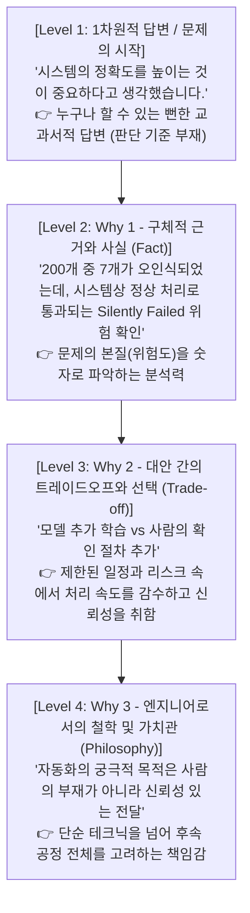

# [면접·자소서 고득점 프레임워크] 3단계 Why 의사결정 논리 구조화 가이드

본 문서는 **면접관의 꼬리질문(Why)을 통해 지원자의 '진짜 의사결정 기준'을 발굴하고, 이를 바탕으로 자소서 및 면접 첫 답변(두괄식)을 고득점으로 환골탈태시키는 프레임워크**입니다.

---

## 1. 프레임워크 핵심 개요: '3단계 Why' 모델

지원자가 프로젝트에서 내린 결정에 대해 면접관은 3단계의 깊이 있는 질문을 던집니다.  
일반적인 지원자는 1단계 질문에서 "정확도를 높이기 위해서였다", "열심히 하기 위해서였다"는 교과서적 답변으로 끝나지만, **합격하는 지원자는 3단계의 의사결정 기준과 철학**을 명확히 제시합니다.



---

## 2. 가상 사례로 보는 심화 흐름 (부품 자동 분류 시스템)

### [기본 상황]
* **프로젝트 목표**: 카메라로 부품 상자의 품번을 인식하여 **완전 자동 분류(무인화)**
* **후반부 변경**: 일부 품목에 대해 **'사람이 다시 확인하도록 변경'** (원래 목표인 무인화에서 후퇴)
* **초기 질문**: *"완전 자동화가 목표였는데, 왜 사람의 확인 절차를 추가했나요?"*
* **기존 답변 (Before)**:
  > ❌ **"시스템의 정확도를 높이는 것이 중요하다고 생각했기 때문입니다."**  
  > *(평가: 틀린 말은 아니지만, 왜 그런 결정을 내렸는지 지원자의 주도적 판단 기준을 알 수 없음)*

---

### [3단계 Why 전개 과정]

### ① Why 1. 왜 그 상황에서 정확도(A)가 문제라고 판단했는가? (구체적 상황/근거)
* **면접관 질문**: *"정확도를 높이는 게 중요하다고 하셨는데, 왜 그 시점에서 정확도가 문제라고 판단하신 건가요?"*
* **지원자 답변**:
  1. 실제 테스트에서 품번이 비슷한 상자들을 잘못 인식하는 문제가 발생했습니다.
  2. **200개를 테스트했는데 7개가 다른 품목으로 분류**되었습니다.
  3. 더 큰 문제는 **그 7개도 시스템에서는 정상적으로 분류가 완료된 것처럼 표시**된다는 점이었습니다.
  4. 그래서 잘못된 부품이 다음 작업 단계로 넘어갈 수 있다고 생각했습니다.
* **핵심 포인트**: 단순한 주장이 아니라, **구체적인 수치(200개 중 7개)와 치명적인 숨은 위험(정상으로 오인식되어 통과됨)**을 밝힘.

---

### ② Why 2. 왜 다른 방법(B)이 아니라 그 방법(A)을 선택했는가? (트레이드오프와 제약)
* **면접관 질문**: *"모델을 추가 학습시켜도 정확도를 개선할 수 있었을 텐데, 왜 굳이 '사람의 확인 절차'를 추가하는 방법을 선택했습니까?"*
* **지원자 답변**:
  1. 추가 학습도 검토했습니다.
  2. 하지만 **최종 시험까지 남은 기간이 짧았고**, 모델을 개선하더라도 실제 오인식 문제가 충분히 해결되는지 **검증할 시간이 부족**했습니다.
  3. 그래서 자동 분류 기능은 유지하되, 인식이 불확실하거나 오류가 반복된 품번은 사람이 확인하도록 했습니다.
  4. **처리 속도가 일부 느려지더라도, 잘못된 품목이 확인 없이 다음 단계로 넘어가는 위험을 줄이는 게 우선**이라고 판단했습니다.
* **핵심 포인트**: 일정과 완성도, 정확도와 속도라는 **제약 조건(Constraint) 속에서 무엇을 선택하고 무엇을 감수(포기)했는지** 의사결정 기준을 증명.

---

### ③ Why 3. 왜 그 판단 기준이 나에게 중요했는가? (엔지니어링 철학/가치관)
* **면접관 질문**: *"자동화 시스템에서는 처리 속도도 중요한 성능인데, 왜 속도가 느려지는 것을 감수하면서까지 확인 절차를 추가하는 게 더 낫다고 판단하셨나요?"*
* **지원자 답변**:
  1. 저는 자동화 시스템에서 중요한 것이 **사람이 개입하지 않는다는 사실 자체보다는 그 결과를 실제 작업에 믿고 사용할 수 있어야 한다**는 점이라고 생각했습니다.
  2. 잘못 분류된 상자가 정상 처리된 것처럼 넘어가면, 다음 작업자는 그 결과가 맞다고 믿고 사용하게 됩니다.
  3. 앞 단계의 오류 때문에 **다음 작업(후속 공정)에서 더 큰 문제(대형 불량, 재작업 비용)**가 생길 수 있습니다.
  4. 그래서 확실하지 않은 결과를 정상으로 처리하기보다, **확인이 필요한 결과를 명확히 구분해 전달하는 것이 더 책임 있는 시스템 설계**라고 생각했습니다.
* **핵심 포인트**: 자기 일에만 갇히지 않고, **후속 작업자와 전체 시스템의 신뢰성을 고려하는 '책임감 있는 설계 철학'**을 드러냄.

---

## 3. 그 기준으로 '첫 답변(자소서 소제목 및 두괄식)'을 다시 만든다

3단계 Why를 통해 발굴한 기준을 바탕으로, 답변의 첫머리(두괄식 문장)를 완전히 새롭게 재구성합니다.

| 구분 | 답변 내용 | 면접관의 반응 |
| :---: | :--- | :--- |
| **기존 답변 (Before)** | "시스템의 정확도를 높이는 것이 중요하다고 생각하기 때문입니다." | 지루하고 뻔함. "누구나 다 그렇게 생각하지 않나?" |
| **다시 쓴 답변 (After)** | **"저는 자동화율을 높이는 것보다는, 잘못된 분류 결과가 정상 처리된 것처럼 다음 단계로 넘어가지 않도록 하는 게 더 중요하다고 판단했습니다."** | 흥미 유발. 문제 상황과 명확한 우선순위 기준이 즉시 전달됨. |

### 🎯 첫 답변을 바꾼 후 유도되는 고득점 후속 질문
지원자가 자신의 판단 기준을 두괄식으로 던지면, 면접관은 준비된 역량을 검증하는 질문을 던질 수밖에 없습니다:
1. *"그러면 어떤 기준으로 사람의 확인 대상을 정했나요?"* ➔ **(알고리즘 임계치/판별 로직 설명)**
2. *"사람이 확인하도록 바꾼 뒤에, 오류가 좀 감소했습니까?"* ➔ **(정량적 성과 제시)**
3. *"왜 처리 속도보다 신뢰성이 더 중요하다고 봤나요?"* ➔ **(준비된 엔지니어링 철학 발화)**

---

## 4. 자소서 및 실전 면접 적용을 위한 3단계 자가 점검 공식

자기소개서 작성이나 면접 답변을 준비할 때, 본인의 프로젝트 경험 소재 1개를 선택하여 아래 3가지 질문을 스스로에게 던지고 답변을 채워 넣습니다.

```text
[실전 작성 템플릿]

1. 문제 상황 (Why 1):
   - 왜 그 상황에서 개선/변경(A)이 반드시 필요하다고 판단했는가?
   - 구체적인 데이터/수치와 겉으로 드러나지 않았던 '숨은 치명적 리스크'는 무엇인가?

2. 선택의 기준 & 트레이드오프 (Why 2):
   - 대안 B(예: 전면 재개발, 모델 재학습 등) 대신 왜 A를 선택했는가?
   - 당시의 제약 조건(시간, 자원, 인력)은 무엇이었으며, 무엇을 얻기 위해 무엇을 감수(포기)했는가?

3. 직업적 가치관 & 철학 (Why 3):
   - 그 선택의 이면에 있는 나의 엔지니어링 철학(기준)은 무엇인가?
   - 후속 공정, 협업 부서, 혹은 고객 관점에서 왜 그 가치가 가장 우선되어야 했는가?
```

---

## 5. 반도체(SK하이닉스 등) 직무 실전 적용 맵

| 의사결정 충돌 상황 | 1차원적 생각 | 3단계 Why를 적용한 고득점 관점 |
| :--- | :--- | :--- |
| **정확도 vs 처리 속도 (수율 vs 생산성)** | "수율과 생산성 둘 다 중요합니다." | 후속 공정에 결함이 전파되었을 때의 웨이퍼 스크랩 비용을 고려하여, **택트 타임(속도) 저하를 감수하고 인라인 계측 및 피드포워드(APC) 인터락을 강화**함. |
| **일정 vs 완성도 (납기 vs 품질)** | "야근을 해서라도 둘 다 맞추겠습니다." | 납기는 전체 Fab 양산 일정과의 약속이므로, **필수 핵심 기능(MVP)을 무결점으로 기한 내 우선 가동**하고 부가 최적화는 2단계 업데이트로 분리하는 단계적 고도화를 택함. |
